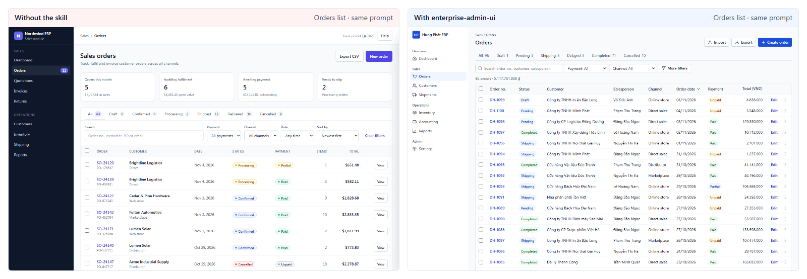
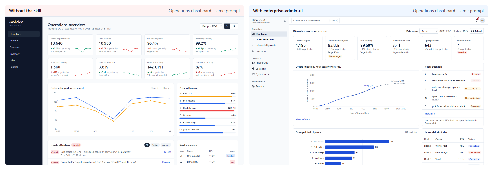
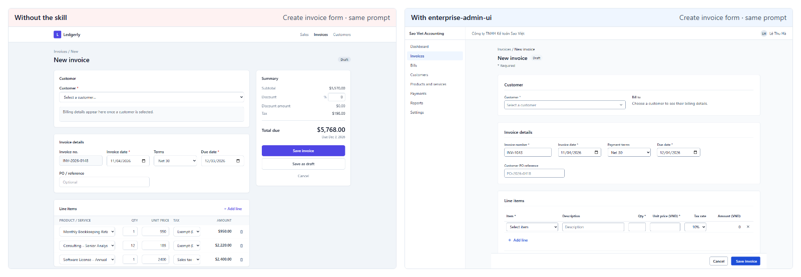

# enterprise-admin-ui

**English** · [Tiếng Việt](README.vi.md) · [简体中文](README.zh-CN.md)

**Enterprise-grade UI for the apps behind the login.** This Agent Skill teaches AI coding agents (Claude Code, Codex, Cursor, Antigravity, Copilot and others) to build management screens the way mature business software does: dense, readable tables; complete states; saving that never loses work; and none of the "AI template" look.



   

## Install

```bash
npx skills add vietIT2002/enterprise-admin-ui
```

The `skills` CLI detects the agents on your machine and copies the skill into the right folder.
On Windows, add `--copy` so the CLI copies the files instead of symlinking them.


<details>
<summary><b>Manual install (any agent)</b></summary>

Copy the folder `skills/enterprise-admin-ui` into your project or user skills folder. Copy it rather than symlink it, because symlinks break on Windows.

| Agent | Project folder |
|---|---|
| Claude Code | `.claude/skills/enterprise-admin-ui` |
| Codex, Cursor, Antigravity, OpenCode, Amp, Cline | `.agents/skills/enterprise-admin-ui` |
| GitHub Copilot | `.github/skills/enterprise-admin-ui` (also reads `.agents/skills`) |
| Kiro | `.kiro/skills/enterprise-admin-ui` |

</details>

<details>
<summary><b>Plugin marketplaces (Claude Code, Antigravity, GitHub CLI, Kiro)</b></summary>

Claude Code:

```text
/plugin marketplace add vietIT2002/enterprise-admin-ui
/plugin install enterprise-admin-ui@enterprise-admin-ui
```

Antigravity:

```bash
agy plugin install https://github.com/vietIT2002/enterprise-admin-ui
```

GitHub CLI 2.90 or later (`gh skill` is in public preview):

```bash
gh skill install vietIT2002/enterprise-admin-ui enterprise-admin-ui
```

Kiro: import from GitHub using the skill folder URL `https://github.com/vietIT2002/enterprise-admin-ui/tree/main/skills/enterprise-admin-ui`.

</details>

<details>
<summary><b>Always-on rules (AGENTS.md, Cursor, Copilot)</b></summary>

Skills load when the agent decides they apply. To keep the core rules in every session, paste a generated snippet into your project:

| File | Paste into |
|---|---|
| [`adapters/AGENTS.snippet.md`](adapters/AGENTS.snippet.md) | `AGENTS.md` or `CLAUDE.md` |
| [`adapters/cursor/enterprise-admin-ui.mdc`](adapters/cursor/enterprise-admin-ui.mdc) | `.cursor/rules/` |
| [`adapters/copilot-instructions.snippet.md`](adapters/copilot-instructions.snippet.md) | `.github/copilot-instructions.md` |

</details>

To use it, ask for a management screen ("build the orders page for our ERP"). Or call the skill by name: `/enterprise-admin-ui` in Claude Code, `$enterprise-admin-ui` in Codex.

## Scope

The skill covers screens behind a login:
- admin panels and back-office tools;
- ERP, CRM, HRM, accounting, inventory and POS back-office;
- internal tools and B2B SaaS app screens.

It is not for landing pages or marketing sites. For those, use an aesthetics skill such as `frontend-design`.

If your project already has a design system or a customised component library, the skill keeps your components and tokens and applies only the layout, state and behaviour rules.

## What's inside

```
skills/enterprise-admin-ui/
├─ SKILL.md            193 lines: workflow, page recipes, states, saving, tables, foundations, Review mode
├─ references/         13 files, loaded only when the task needs them
├─ scripts/audit.js    dependency-free browser audit, 18 rules, score 0–100
└─ assets/
   ├─ tokens.css           shadcn-compatible tokens, light and dark, Tailwind v4 @theme
   └─ DESIGN.template.md   per-project decision file (Google design.md format)
```

**Page recipes:** list, record detail, create/edit form, dashboard, settings, wizard and CSV import, plus roles, permissions and approvals. Each recipe says what the screen contains, and in what order.

**References:**

| File | Covers |
|---|---|
| `tables.md` | density, alignment, sorting, selection, pagination, inline edit |
| `filters-search.md` | filter bars, chips, saved views, search, URL state |
| `forms.md` | layout, validation, save models, line items, unsaved changes |
| `feedback-states.md` | empty, loading and error states, toasts vs banners, confirmations, long jobs |
| `permissions-audit.md` | roles, approvals, audit history, status vocabulary |
| `navigation-layout.md` | app shell, sidebar, page header, breadcrumbs, settings navigation |
| `dashboards-charts.md` | operational dashboards, KPI tiles, chart choice |
| `tokens.md` | applying tokens in shadcn, Tailwind v3/v4 or plain CSS |
| `data-formatting.md` | numbers, money, dates, time zones, empty values, a vi-VN profile |
| `bulk-import-export.md` | select all matching, partial failures, CSV import, export |
| `accessibility.md` | WCAG 2.2 AA checklist for admin screens |
| `anti-patterns.md` | 23 "AI template" tells, each with its fix and a way to detect it |
| `react-shadcn.md` | TanStack Table, react-hook-form + zod, URL state, shadcn Sidebar |

**Review mode.** Ask the agent to "review this screen". It reports findings as `path:line — rule — fix`, grouped by level (`data`, `states`, `a11y`, `layout`, `tells`), and changes code only when you ask.

**Audit.** With a browser, inject `scripts/audit.js` and run `enterpriseAdminAudit({ pageType: 'list' })`. It measures:
- type size and scale;
- radius;
- row height and stacked rows;
- numeric alignment and tabular figures;
- control names and target size;
- text contrast;
- gradients, glass and card shadows;
- ALL-CAPS labels;
- emoji icons;
- primary actions per header;
- hidden elements that a `flex` class keeps visible.

## Results

The same model (Claude Sonnet 5.5) built the same screens from the same prompts, in English and Vietnamese, without and with the skill. An automated audit and an acceptance checklist judged the pages.

| | Without | With the skill |
|---|---|---|
| Median audit score (40 pages each) | 82 | **100** |
| Pages with low-contrast text | 68% | **0%** |
| Pages with ALL-CAPS labels | 73% | **0%** |
| Acceptance checklist, 3 screens the skill was never written against (6 pages each) | 35% | **72%** |
| Acceptance checklist, 8 main screens (16 reviews each)\* | 56% | 100% |

\* The skill's recipes were written from the failures on these 8 screens, so this row overstates how it does on new screens. The row above is the fairer number.





**Not measured yet:**
- other agents (Codex, Cursor, Copilot);
- real React/shadcn codebases;
- how often the skill triggers without being named.

## How it compares

| Skill | Focus | Management-screen workflow |
|---|---|---|
| `frontend-design` (Anthropic) | Distinctive aesthetics, "aesthetic risk" | Not its goal |
| `ui-ux-pro-max` | Catalogue of styles and product types | Light (a line on bulk actions) |
| `taste-skill` | Art direction, app screens, a "tells" table | Partial |
| **enterprise-admin-ui** | Deliberately unflashy business screens | Lists, filters, bulk actions, line-item forms, permissions, audit history, approvals, import, locale formatting, all states |

The skills work together. Use an aesthetics skill for the marketing site and this one for the app behind the login.

## FAQ

**Will it fight my design system?** No. A project design system or customised component library always wins; the skill then applies only layout, state and behaviour rules. A `DESIGN.md` in the project records your accent, density and status vocabulary, and the skill reads it first.

**How many tokens does it cost?** `SKILL.md` is 193 lines. References load only when the task needs them, for example `tables.md` for a table.

**Does it handle Vietnamese and other locales?** Yes. Formatting goes through `Intl` with the project locale. `data-formatting.md` has a vi-VN profile:
- `1.250.000 ₫`;
- `dd/MM/yyyy HH:mm`;
- `Asia/Ho_Chi_Minh`;
- diacritic-insensitive search.

**How do I update?** Run `npx skills add vietIT2002/enterprise-admin-ui` again, or copy the folder again. See [CHANGELOG.md](CHANGELOG.md).

**Does it work without React?** Yes. The rules are stack-neutral, and the examples use React, Tailwind and shadcn/ui. Single-file HTML with the Tailwind CDN is covered too.

## License

[MIT](LICENSE)
