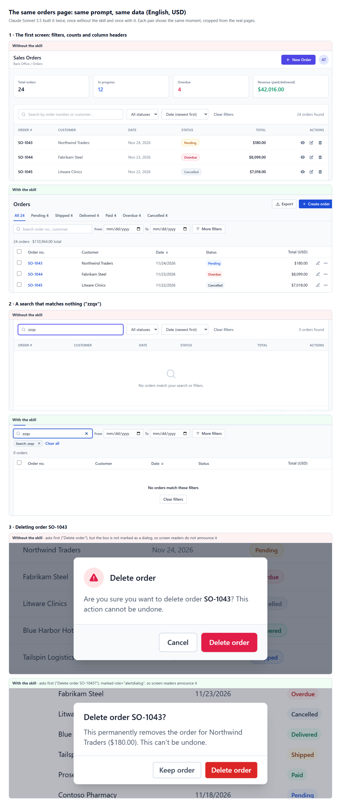
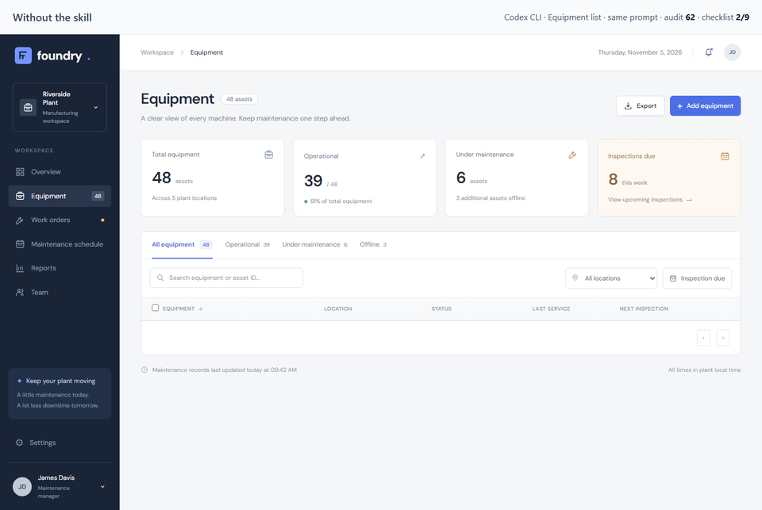
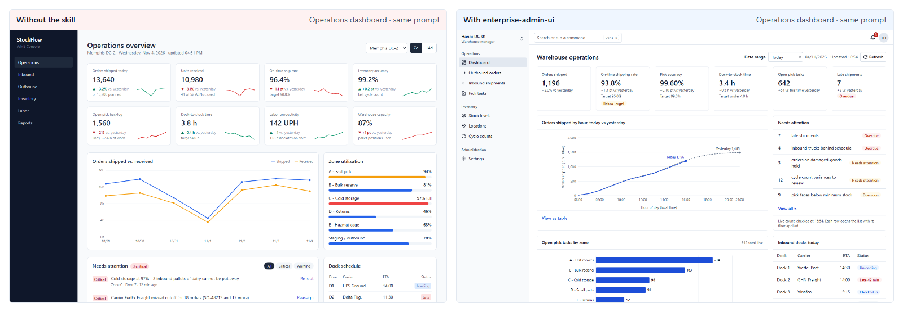
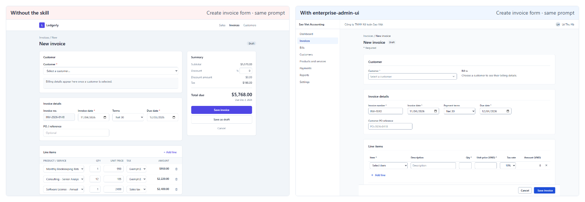

# enterprise-admin-ui

[English](README.md) · **Tiếng Việt** · [简体中文](README.zh-CN.md)

**AI coding agent hay dựng màn hình quản trị trông như đã xong nhưng hỏng khi dùng thật.** Agent Skill này giúp Claude Code, Codex, Cursor, GitHub Copilot và các agent khác dựng các màn hình đó theo cách phần mềm doanh nghiệp lâu năm vẫn làm.

| Agent thường làm ra | Skill yêu cầu agent dựng |
|---|---|
| Bảng chỉ có một ô tìm kiếm | Bộ lọc với các thẻ gỡ được, và số kết quả đi theo bộ lọc ("12 trên 48 đơn") |
| Form làm mất những gì bạn đã nhập khi lưu bị lỗi | Lỗi hiện cạnh từng ô, phần tóm tắt lỗi nhận focus, và mọi thứ bạn đã nhập vẫn còn |
| Nút Xóa xóa ngay lập tức | Hộp xác nhận nêu tên bản ghi và điều sẽ xảy ra với nó |
| Vùng trống khi đang tải, không có gì khi yêu cầu bị lỗi | Khung chờ khi đang tải, thông báo lỗi có nút Thử lại, và trạng thái trống kèm việc cần làm tiếp |
| Nhãn VIẾT HOA màu xám nhỏ và ô KPI ở mọi trang | Chữ 14px dễ đọc, viết hoa đầu câu, bảng nằm ngay màn hình đầu |

| 1 · Xem | 2 · Cài | 3 · Thử một prompt |
|---|---|---|
| [Cùng các màn hình, không có và có skill](https://vietit2002.github.io/enterprise-admin-ui-benchmark/?suite=heldout3) | `npx skills add vietIT2002/enterprise-admin-ui`<br>Windows: `npx.cmd skills add vietIT2002/enterprise-admin-ui --copy` | `/enterprise-admin-ui Làm trang danh sách đơn hàng cho ERP: bộ lọc, thao tác hàng loạt, phân trang` |



**Đo trên các màn hình không ai tinh chỉnh skill cho chúng** (12 màn hình, checklist viết độc lập, chấm mù): các trang dựng với skill làm được **44%** những gì mỗi màn hình cần, so với **19%** khi không có skill. Theo nhóm: trạng thái trống, đang tải và lỗi 12% → 59%; tìm kiếm, bộ lọc và số đếm 16% → 54%; xác nhận trước khi xóa 25% → 63%. Skill giúp agent làm đúng nhiều hơn gấp đôi, và phần còn lại vẫn cần bạn kiểm tra. [Cách đo](#kết-quả).

[](https://github.com/vietIT2002/enterprise-admin-ui/actions/workflows/ci.yml)    

## Cài đặt

Mở terminal tại thư mục dự án rồi chạy lệnh dành cho hệ điều hành của bạn. CLI `skills` cần Node.js 22.20 trở lên. CLI sẽ hỏi bạn cài cho agent nào, rồi đặt skill vào thư mục của từng agent.

**macOS / Linux** (Terminal):

```bash
npx skills add vietIT2002/enterprise-admin-ui
```

**Windows** (PowerShell):

```powershell
npx.cmd skills add vietIT2002/enterprise-admin-ui --copy
```

- Dùng `npx.cmd` thay cho `npx`. Chính sách mặc định của PowerShell chặn `npx.ps1` với lỗi "running scripts is disabled on this system". Trong Command Prompt (cmd), `npx` chạy bình thường.
- `--copy` chép file thật. Nếu thiếu tùy chọn này, khi cài cho nhiều agent CLI sẽ tạo junction trỏ tới đường dẫn tuyệt đối, và liên kết đó hỏng khi dự án bị chuyển chỗ hoặc được clone sang máy khác.

<details>
<summary><b>Tùy chọn, cài cho mọi dự án, cập nhật</b></summary>

Các tùy chọn hay dùng, giống nhau trên mọi hệ điều hành:
- `-a claude-code` chọn agent mà không cần trả lời câu hỏi (có cả `codex`, `cursor`, `github-copilot`, `antigravity` …), còn `-y` bỏ qua các bước xác nhận.
- `-g` cài vào thư mục người dùng để mọi dự án đều dùng được, thay vì chỉ dự án hiện tại.

Ví dụ, cài cho Claude Code ở mọi dự án:

```bash
# macOS / Linux
npx skills add vietIT2002/enterprise-admin-ui -g -a claude-code -y
```

```powershell
# Windows
npx.cmd skills add vietIT2002/enterprise-admin-ui -g -a claude-code -y --copy
```

Để cập nhật về sau, chạy `npx skills update` (trên Windows: `npx.cmd skills update`).

</details>

<details>
<summary><b>Cài thủ công (mọi agent)</b></summary>

Chép thư mục `skills/enterprise-admin-ui` vào thư mục skill của agent (xem bảng). Các lệnh dưới đây cài cho Claude Code trong dự án hiện tại; với agent khác, đổi `.claude/skills` thành thư mục tương ứng.

macOS / Linux:

```bash
T=$(mktemp -d)
git clone --depth 1 https://github.com/vietIT2002/enterprise-admin-ui.git "$T"
mkdir -p .claude/skills && cp -R "$T/skills/enterprise-admin-ui" .claude/skills/
```

Windows (PowerShell):

```powershell
$t = Join-Path $env:TEMP ([guid]::NewGuid())
git clone --depth 1 https://github.com/vietIT2002/enterprise-admin-ui.git $t
New-Item -ItemType Directory -Force .claude\skills | Out-Null
Copy-Item -Recurse -Force "$t\skills\enterprise-admin-ui" .claude\skills\
```

Hãy chép thay vì tạo symlink, vì symlink không ổn định trên Windows.

| Agent | Thư mục trong dự án | Thư mục người dùng |
|---|---|---|
| Claude Code | `.claude/skills/` | `~/.claude/skills/` |
| Codex | `.agents/skills/` | `~/.agents/skills/` |
| Cursor | `.agents/skills/` hoặc `.cursor/skills/` | `~/.agents/skills/` hoặc `~/.cursor/skills/` |
| GitHub Copilot | `.github/skills/` hoặc `.agents/skills/` | `~/.copilot/skills/` |
| Antigravity | `.agents/skills/` | `~/.gemini/config/skills/` |
| Kiro | `.kiro/skills/` | `~/.kiro/skills/` |

</details>

<details>
<summary><b>Plugin và các trình cài đặt khác</b></summary>

Plugin marketplace của Claude Code:

```text
/plugin marketplace add vietIT2002/enterprise-admin-ui
/plugin install enterprise-admin-ui@enterprise-admin-ui
```

GitHub CLI 2.90 trở lên (`gh skill` đang ở bản public preview). Mặc định lệnh này cài cho GitHub Copilot; với các agent khác, thêm `--agent claude-code`, `--agent cursor`, v.v.:

```bash
gh skill install vietIT2002/enterprise-admin-ui enterprise-admin-ui
```

Kiro: import từ GitHub bằng URL của thư mục skill `https://github.com/vietIT2002/enterprise-admin-ui/tree/main/skills/enterprise-admin-ui`.

Chưa được kiểm thử trọn vẹn từ đầu đến cuối (các manifest được viết theo định dạng đã công bố):

```bash
agy plugin install https://github.com/vietIT2002/enterprise-admin-ui
codex plugin marketplace add vietIT2002/enterprise-admin-ui
```

</details>

<details>
<summary><b>Quy tắc luôn bật (AGENTS.md, Cursor, Copilot)</b></summary>

Skill chỉ được nạp khi agent thấy cần dùng. Để các quy tắc cốt lõi có mặt trong mọi phiên làm việc, dán một snippet đã tạo sẵn vào dự án:

| File | Dán vào |
|---|---|
| [`adapters/AGENTS.snippet.md`](adapters/AGENTS.snippet.md) | `AGENTS.md` hoặc `CLAUDE.md` |
| [`adapters/cursor/enterprise-admin-ui.mdc`](adapters/cursor/enterprise-admin-ui.mdc) | `.cursor/rules/` (file này dùng `alwaysApply: true`) |
| [`adapters/copilot-instructions.snippet.md`](adapters/copilot-instructions.snippet.md) | `.github/copilot-instructions.md` |

</details>

## Dùng trong dự án

Sau khi cài, mở dự án bằng agent và bắt đầu một phiên mới để agent nhận ra skill. Sau đó gõ:

| Agent | Gõ vào khung chat |
|---|---|
| Claude Code | `/enterprise-admin-ui` kèm yêu cầu (nếu cài dạng plugin: `/enterprise-admin-ui:enterprise-admin-ui`) |
| Codex | `$enterprise-admin-ui` kèm yêu cầu, hoặc chọn skill trong `/skills` |
| Cursor | `/enterprise-admin-ui` trong Agent chat |
| GitHub Copilot trong VS Code | `/enterprise-admin-ui` trong chat |
| Antigravity, Kiro và các agent khác | Yêu cầu của bạn, thêm câu "dùng skill enterprise-admin-ui" |

Ví dụ:

```text
/enterprise-admin-ui Làm trang danh sách đơn hàng cho ERP: bộ lọc, thao tác hàng loạt, phân trang
/enterprise-admin-ui Làm form tạo/sửa khách hàng có kiểm tra dữ liệu và nút Lưu nháp
/enterprise-admin-ui Review app/orders/page.tsx
```

- **Xây màn hình:** nêu tên màn hình và dữ liệu của nó. Với dự án có nhiều màn hình, skill tạo `DESIGN.md` trước (sản phẩm, vai trò, locale, tên trạng thái) từ câu trả lời của bạn hoặc từ code, và các màn hình sau đều theo file này.
- **Review:** yêu cầu "review" hoặc "audit". Skill liệt kê lỗi dạng `path:line — rule — fix`, nhóm theo mức độ, và chỉ sửa code khi bạn yêu cầu.
- **Không bắt buộc gõ lệnh:** chỉ cần yêu cầu một màn hình quản lý là skill tự nạp (20/20 prompt trong Claude Code). Gọi tên skill để chắc chắn.

## Phạm vi

Skill dành cho các màn hình nằm sau màn hình đăng nhập:
- trang quản trị và công cụ back-office;
- back-office ERP, CRM, HRM, kế toán, kho và POS;
- công cụ nội bộ và màn hình ứng dụng B2B SaaS.

Skill không dành cho landing page hay website marketing. Với những trang đó, hãy dùng một skill về thẩm mỹ như `frontend-design`.

Nếu dự án đã có design system hoặc thư viện component tùy biến, skill giữ nguyên component và token của bạn, chỉ áp dụng các quy tắc về bố cục, trạng thái và hành vi.

## Bên trong có gì

```
skills/enterprise-admin-ui/
├─ SKILL.md            250 dòng: quy trình, công thức trang, trạng thái, lưu, bảng, nền tảng, Review mode
├─ references/         17 file, chỉ nạp khi tác vụ cần
├─ scripts/audit.js    audit chạy trên trình duyệt, không cần thư viện ngoài, 22 quy tắc, điểm 0–100
├─ scripts/audit-cli.mjs  chạy audit từ terminal bằng Chrome hoặc Edge chạy ngầm, không cần thư viện ngoài
├─ scripts/check.mjs   tùy chọn: phép thử hành vi trong Chromium (Playwright), mỗi lỗi một dòng
└─ assets/
   ├─ templates/           tùy chọn: trang danh sách, chi tiết và form dạng một file HTML
   ├─ tokens.css           token tương thích shadcn, sáng và tối, Tailwind v4 @theme
   └─ DESIGN.template.md   file ghi quyết định riêng của từng dự án (định dạng design.md của Google)
```

**Công thức trang:** danh sách, chi tiết bản ghi, form tạo/sửa, dashboard, cài đặt, wizard và nhập CSV, cùng với vai trò, phân quyền và phê duyệt. Mỗi công thức nêu màn hình gồm những gì, và theo thứ tự nào.

**Tài liệu tham khảo:**

| File | Nội dung |
|---|---|
| `tables.md` | mật độ, căn lề, sắp xếp, chọn hàng, phân trang, sửa trực tiếp trên bảng |
| `filters-search.md` | thanh bộ lọc, chip, view đã lưu, tìm kiếm, trạng thái trên URL |
| `forms.md` | bố cục, kiểm tra dữ liệu, cách lưu, dòng hàng, thay đổi chưa lưu |
| `feedback-states.md` | trạng thái trống, đang tải và lỗi, khi nào dùng toast hay banner, xác nhận, tác vụ chạy lâu |
| `permissions-audit.md` | vai trò, phê duyệt, lịch sử thay đổi, bộ từ vựng trạng thái |
| `navigation-layout.md` | khung ứng dụng, sidebar, header trang, breadcrumb, điều hướng trang cài đặt |
| `dashboards-charts.md` | dashboard vận hành, ô KPI, chọn loại biểu đồ |
| `tokens.md` | áp dụng token trong shadcn, Tailwind v3/v4 hoặc CSS thuần |
| `data-formatting.md` | số, tiền, ngày, múi giờ, giá trị trống, bộ quy ước vi-VN |
| `bulk-import-export.md` | chọn tất cả bản ghi khớp bộ lọc, lỗi một phần, nhập CSV, xuất dữ liệu |
| `accessibility.md` | checklist WCAG 2.2 AA cho màn hình quản trị |
| `anti-patterns.md` | 23 dấu hiệu "template AI", mỗi dấu hiệu kèm cách sửa và cách phát hiện |
| `react-shadcn.md` | TanStack Table, react-hook-form + zod, trạng thái trên URL, shadcn Sidebar |
| `reports-print.md` | báo cáo (kỳ, so sánh, tổng, xuất file) và chứng từ in (hoá đơn, phiếu lương) |
| `calendars.md` | lịch nghỉ phép, lịch ca, đặt lịch: ngày đầu tuần, thanh nhiều ngày, số người nghỉ, bàn phím |
| `boards.md` | bảng Kanban: cột và giới hạn, chuyển thẻ không cần kéo thả, chi tiết ở bảng bên |
| `trees.md` | cây và màn hình chia đôi: hệ thống tài khoản, sơ đồ tổ chức, danh mục |

**Review mode.** Yêu cầu agent "review màn hình này". Agent báo các vấn đề theo dạng `path:line — rule — fix`, nhóm theo cấp (`data`, `states`, `a11y`, `layout`, `tells`), và chỉ sửa code khi bạn yêu cầu.

**Audit.** Chạy từ terminal, không cần thư viện ngoài:

```bash
node <thư mục skill>/scripts/audit-cli.mjs http://localhost:3000/orders --type list
```

`<thư mục skill>` là nơi cài skill, ví dụ `.claude/skills/enterprise-admin-ui`. Đầu vào có thể là URL hoặc file HTML; đường dẫn file tương đối được tính từ thư mục bạn đang chạy lệnh. CLI mở trang ở kích thước 1440×900 bằng Chrome, Edge hoặc Chromium có sẵn trên máy và in điểm. Lệnh trả mã thoát 1 khi có lỗi ✗, nên agent hoặc CI có thể dựa vào đó. Với trang dùng dữ liệu giả, thêm `--states`: CLI mở thêm `?state=empty`, `?state=error` và `?state=loading` rồi kiểm tra từng trạng thái: trạng thái rỗng không còn hàng dữ liệu và có hành động riêng, trạng thái lỗi có thông báo `role="alert"` và nút Thử lại, trạng thái đang tải có skeleton. Trong console của trình duyệt hoặc với Playwright, bạn cũng có thể chèn `scripts/audit.js` vào trang và chạy `enterpriseAdminAudit({ pageType: 'list' })`. Audit đo:
- cỡ chữ và thang cỡ chữ;
- độ bo góc;
- chiều cao hàng và hàng bị dồn thành nhiều dòng;
- căn lề cột số và chữ số đều độ rộng (tabular figures);
- bảng bị đẩy xuống dưới màn hình đầu tiên trên trang danh sách;
- tên của control và kích thước vùng bấm;
- độ tương phản của chữ;
- gradient, hiệu ứng kính và bóng đổ của card;
- nhãn VIẾT HOA TOÀN BỘ;
- icon emoji;
- số thao tác chính trong mỗi header;
- phần tử lẽ ra bị ẩn nhưng vẫn hiện vì class `flex` hoặc `grid`;
- thanh thao tác hoặc tiêu đề bảng `sticky` không bao giờ dính, vì khung `overflow` bọc ngoài dài ra theo nội dung thay vì tự cuộn;
- nhãn form nằm cạnh ô nhập thay vì ở trên, và ô email hoặc điện thoại thiếu `type="email"` hoặc `type="tel"`;
- email và số điện thoại hiển thị dạng chữ thường thay vì link `mailto:` và `tel:`.

## Kết quả

Benchmark cho ra hai loại số. Chúng trả lời hai câu hỏi khác nhau, nên cần đọc riêng:

| Câu hỏi | Cách đo | Không có skill | Có skill |
|---|---|---|---|
| **Trang có làm được việc màn hình cần không?** | Checklist nghiệm thu cho từng màn hình, do một agent chưa từng đọc skill viết. Mỗi trang một reviewer, không biết trang do cách nào dựng. 12 màn hình, mỗi bên 108 mục | 19% | **44%** |
| Trang có theo quy tắc của chính skill không? | Audit của skill (`audit.js`): cỡ chữ, độ tương phản, căn lề, chiều cao dòng và dấu hiệu template, điểm 0–100. Cùng 12 màn hình, điểm trung vị | 69 | 90 |

Một trang có thể đạt 100 điểm audit mà vẫn thiếu nhiều thứ màn hình cần. Audit kiểm tra những quy tắc mà trình duyệt đo được; checklist kiểm tra màn hình có làm được việc của nó không. Hãy đánh giá skill bằng dòng đầu tiên: skill giúp agent làm đúng nhiều hơn gấp đôi, và hơn một nửa vẫn cần bạn kiểm tra.

Skill giúp ở đâu và không giúp được ở đâu, trên cùng 12 màn hình:
- **Hành vi UI** (trạng thái, bộ lọc và số đếm, định dạng, hộp xác nhận, bàn phím, in, xuất file): 14% → **51%**.
- **Quy tắc nghiệp vụ mà prompt không nêu** (các khoản khấu trừ bắt buộc trên phiếu lương, che thông tin bí mật trong nhật ký kiểm toán): 26% → 33%. Hãy đưa chúng vào prompt hoặc tài liệu của dự án; skill không biết nghiệp vụ của bạn.

**Dữ liệu:** mọi trang, ảnh chụp, audit và review, cùng đề bài, prompt và công cụ, nằm ở [enterprise-admin-ui-benchmark](https://github.com/vietIT2002/enterprise-admin-ui-benchmark), và [gallery](https://vietit2002.github.io/enterprise-admin-ui-benchmark/) đặt các trang cạnh nhau. Hai bộ đo đứng sau các con số này là [HELDOUT3](https://github.com/vietIT2002/enterprise-admin-ui-benchmark/blob/main/benchmark/runs/2026-11-06-heldout3-claude-green/HELDOUT3.md) và [HELDOUT4](https://github.com/vietIT2002/enterprise-admin-ui-benchmark/blob/main/benchmark/runs/2026-11-06-heldout4-new-claude-green/HELDOUT4.md).

<details>
<summary><b>Các lần đo trước, và vì sao số cao hơn</b></summary>

Các lần đo này có trước. Checklist do chính tác giả skill viết, người biết các quy tắc của nó, và phần lớn reviewer biết trang do cách nào dựng. Các con số độc lập ở trên thấp hơn và công bằng hơn.

- **Phiên bản:** đo ngày 2026-11-04 với v0.1.0 (8 file tham khảo). Các thay đổi của v0.5.0 được kiểm tra lại trên 3 trang mới (điểm audit trung vị 100, checklist 22/22) và trên 9 trang của vòng sửa lỗi, chứ không chạy lại toàn bộ bộ thử nghiệm.
- **Tạo trang:** cùng một model (Claude Sonnet 5.5) dựng cùng các màn hình từ cùng các đề bài, bằng tiếng Anh và tiếng Việt, một lần theo cách bình thường và một lần được yêu cầu đọc `SKILL.md` trước. Kết quả là HTML một file dùng Tailwind CDN.
- **Chấm điểm:**
  - các trang được chấm bằng audit của chính skill (`scripts/audit.js`) và một checklist nghiệm thu;
  - mỗi trang do một agent review đánh giá, và agent này biết trang thuộc nhóm nào. Một lượt chấm mù lại 12 trang khớp 97% số mục và cho cùng mức chênh lệch;
  - các lượt review checklist áp dụng cho lượt chạy 1–2 của mỗi đề bài.

| | Không có skill | Có skill |
|---|---|---|
| Điểm trung vị trên audit của chính skill (mỗi bên 40 trang) | 82 | 100 |
| Trang có chữ tương phản thấp | 68% | 0% |
| Trang có nhãn VIẾT HOA TOÀN BỘ | 73% | 0% |
| Checklist nghiệm thu, 3 màn hình không dùng khi viết skill (mỗi bên 6 trang) | 35% | 72% |
| Checklist nghiệm thu, thêm 3 màn hình mới, với v0.5.2 (mỗi bên 6 trang)† | 39% | 89% |
| Checklist nghiệm thu, 8 màn hình chính (mỗi bên 16 lượt review)\* | 56% | 100% |

\* Các công thức trang của skill được viết từ chính những lỗi trên 8 màn hình này, nên dòng này cho kết quả cao hơn thực tế trên màn hình mới. Các dòng màn hình mới là con số công bằng hơn.

† Các màn hình này được viết sau khi có quy tắc v0.5.2. 4 trong 27 mục checklist kiểm tra trực tiếp các quy tắc đó (5/8 → 8/8); 23 mục còn lại tăng từ 35% lên 87%.







**Môi trường khác** (2026-11-05, cùng 3 màn hình mới, mỗi bên 1 trang mỗi màn hình):
- Codex CLI (`gpt-6.1-sol`): checklist 33% → 96%, điểm audit trung vị 62 → 100.
- Ứng dụng Next.js 16 + shadcn/ui (Sonnet 5.5): checklist 44% → 93%.

</details>

**Tự kích hoạt** (Claude Code, Sonnet 5.5, 2026-11-05): khi không được gọi tên, skill tự nạp ở 20/20 prompt màn hình quản lý (10 EN, 10 VI) và 0/10 prompt landing page.

**Chưa đo:** Cursor và Copilot, và việc skill có tự nạp ở các agent ngoài Claude Code hay không.

## So sánh với các skill khác

Dựa trên repository của từng skill, tính đến ngày 2026-11-04.

| Skill | Trọng tâm | Quy trình cho màn hình quản lý |
|---|---|---|
| `anthropics/skills` · `frontend-design` | Thẩm mỹ khác biệt, "chấp nhận rủi ro thẩm mỹ" | Không phải mục tiêu của nó |
| `nextlevelbuilder/ui-ux-pro-max` | Danh mục phong cách và loại sản phẩm | Ít (một dòng về thao tác hàng loạt) |
| `Leonxlnx/taste-skill` | Định hướng nghệ thuật, màn hình ứng dụng, một bảng "dấu hiệu" (tells) | Một phần |
| `pbakaus/impeccable` | Bộ dò lỗi thiết kế (62 quy tắc), chế độ "Operate" cho màn hình ứng dụng | Một phần (thiếu audit log và phân trang) |
| **enterprise-admin-ui** | Màn hình nghiệp vụ, cố ý không hào nhoáng | Danh sách, bộ lọc, thao tác hàng loạt, form có dòng hàng, phân quyền, lịch sử thay đổi, phê duyệt, nhập dữ liệu, định dạng theo locale, đủ mọi trạng thái |

**Đo trên màn hình quản trị** (chấm mù, cùng 12 đề viết độc lập, mỗi skill 1 trang mỗi đề, Claude Sonnet 5.5): enterprise-admin-ui đạt **44%** checklist nghiệm thu, ui-ux-pro-max 30%, impeccable 19%, frontend-design 18% và không dùng skill 19%. Đây là lĩnh vực sở trường của skill này, và các skill khác chạy không có script của chúng. Xem [COMPARE](https://github.com/vietIT2002/enterprise-admin-ui-benchmark/blob/main/benchmark/runs/2026-11-07-compare-blind/COMPARE.md).

Các skill này dùng kết hợp được với nhau. Dùng một skill thẩm mỹ cho website marketing và skill này cho ứng dụng sau màn hình đăng nhập.

## Câu hỏi thường gặp

**Skill có xung đột với design system của tôi không?** Không. Design system hoặc thư viện component tùy biến của dự án luôn được ưu tiên; khi đó skill chỉ áp dụng các quy tắc về bố cục, trạng thái và hành vi. File `DESIGN.md` trong dự án ghi lại màu nhấn, mật độ và bộ từ vựng trạng thái của bạn, và skill đọc file này trước tiên.

**Skill tốn bao nhiêu token?** `SKILL.md` dài 250 dòng (khoảng 20 KB, tầm 5k token). Các file tham khảo chỉ được nạp khi tác vụ cần, ví dụ `tables.md` khi làm bảng.

**Skill có hỗ trợ tiếng Việt và các locale khác không?** Có. Việc định dạng đi qua `Intl` với locale của dự án. `data-formatting.md` có sẵn bộ quy ước vi-VN:
- `1.250.000 ₫`;
- `dd/MM/yyyy HH:mm`;
- `Asia/Ho_Chi_Minh`;
- tìm kiếm không phân biệt dấu.

**Cập nhật thế nào?** Tùy vào cách bạn đã cài:
- `npx skills add`: chạy `npx skills update` (trên Windows: `npx.cmd skills update`).
- `gh skill`: chạy `gh skill update`.
- Plugin: skill được cập nhật khi phiên bản plugin thay đổi.
- Chép thủ công: chép lại thư mục.

Xem [CHANGELOG.md](CHANGELOG.md).

**Không dùng React thì có được không?** Được. Các quy tắc không phụ thuộc stack, còn ví dụ dùng React, Tailwind và shadcn/ui. HTML một file dùng Tailwind CDN cũng được hỗ trợ.

## Giấy phép

[MIT](LICENSE)
