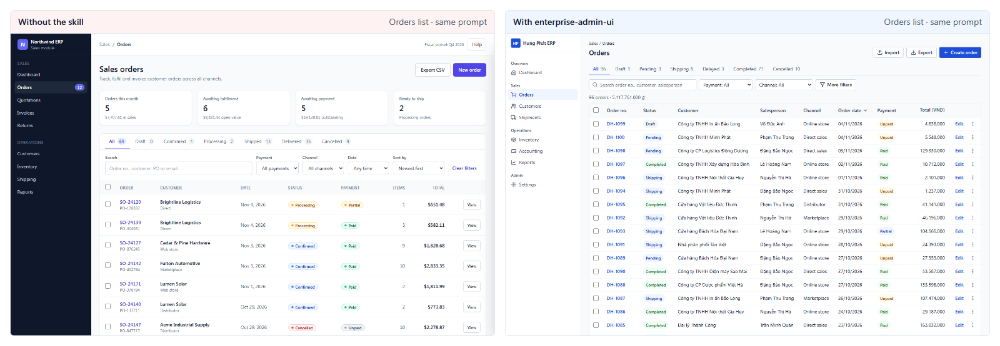
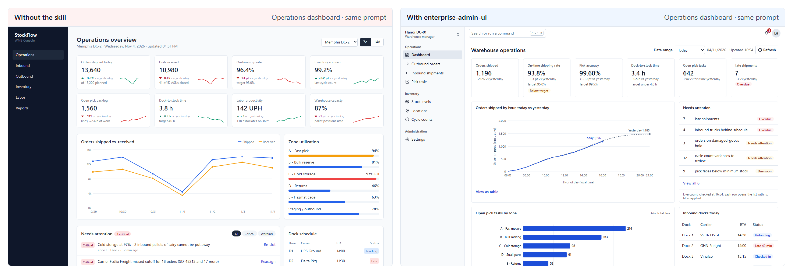
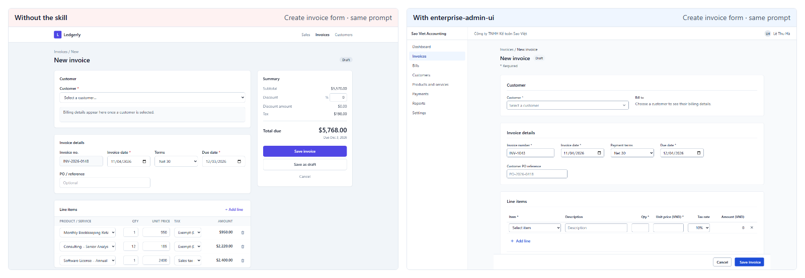

# enterprise-admin-ui

[English](README.md) · [Tiếng Việt](README.vi.md) · **简体中文**

**为登录后的应用提供企业级界面。** 这个 Agent Skill 教 AI 编程 Agent（Claude Code、Codex、Cursor、Antigravity、Copilot 等）像成熟的商业软件那样构建管理系统界面：信息密集且易读的表格；完整的各类状态；不会丢失已填内容的保存机制；也没有那种“AI 模板”味。



   

## 安装

```bash
npx skills add vietIT2002/enterprise-admin-ui
```

`skills` CLI 会检测你机器上已安装的 Agent，并把技能安装到对应的目录。在 Windows 上请加上 `--copy`，让它复制文件而不是创建符号链接。

<details>
<summary><b>手动安装（适用于任何 Agent）</b></summary>

把 `skills/enterprise-admin-ui` 文件夹复制到项目目录或你的用户目录中。请直接复制，不要使用符号链接，因为符号链接在 Windows 上不可靠。

| Agent | 项目目录 | 用户目录 |
|---|---|---|
| Claude Code | `.claude/skills/` | `~/.claude/skills/` |
| Codex | `.agents/skills/` | `~/.agents/skills/` |
| Cursor | `.agents/skills/` 或 `.cursor/skills/` | `~/.agents/skills/` 或 `~/.cursor/skills/` |
| GitHub Copilot | `.github/skills/` 或 `.agents/skills/` | `~/.copilot/skills/` |
| Antigravity | `.agents/skills/` | `~/.gemini/config/skills/` |
| Kiro | `.kiro/skills/` | `~/.kiro/skills/` |

</details>

<details>
<summary><b>插件及其他安装方式</b></summary>

Claude Code 插件市场：

```text
/plugin marketplace add vietIT2002/enterprise-admin-ui
/plugin install enterprise-admin-ui@enterprise-admin-ui
```

GitHub CLI 2.90 及以上（`gh skill` 目前为公开预览版）。默认安装给 GitHub Copilot；如需安装给其他 Agent，可加上 `--agent claude-code`、`--agent cursor` 等参数：

```bash
gh skill install vietIT2002/enterprise-admin-ui enterprise-admin-ui
```

Kiro：从 GitHub 导入，填写技能文件夹的 URL `https://github.com/vietIT2002/enterprise-admin-ui/tree/main/skills/enterprise-admin-ui`。

以下方式尚未做过端到端测试（manifest 文件遵循已公布的格式）：

```bash
agy plugin install https://github.com/vietIT2002/enterprise-admin-ui
codex plugin marketplace add vietIT2002/enterprise-admin-ui
```

</details>

<details>
<summary><b>常驻规则（AGENTS.md、Cursor、Copilot）</b></summary>

技能只会在 Agent 判断适用时才加载。如果希望每个会话都带上核心规则，可以把已生成的片段粘贴到项目中：

| 文件 | 粘贴到 |
|---|---|
| [`adapters/AGENTS.snippet.md`](adapters/AGENTS.snippet.md) | `AGENTS.md` 或 `CLAUDE.md` |
| [`adapters/cursor/enterprise-admin-ui.mdc`](adapters/cursor/enterprise-admin-ui.mdc) | `.cursor/rules/`（该文件使用 `alwaysApply: true`） |
| [`adapters/copilot-instructions.snippet.md`](adapters/copilot-instructions.snippet.md) | `.github/copilot-instructions.md` |

</details>

使用时，直接让 Agent 做一个管理界面即可（例如“为我们的 ERP 做一个订单页面”），也可以让 Agent 使用 enterprise-admin-ui 技能。在 Claude Code 中还可以输入 `/enterprise-admin-ui`；如果是以插件方式安装的，则输入 `/enterprise-admin-ui:enterprise-admin-ui`。

## 适用范围

本技能覆盖登录后的各类界面：
- 管理后台和运营后台工具；
- ERP、CRM、HRM、财务、库存和 POS 后台；
- 内部工具和 B2B SaaS 应用界面。

它不适用于落地页或营销网站。这类页面请使用 `frontend-design` 等侧重视觉美感的技能。

如果项目已有设计系统或定制过的组件库，本技能会保留你的组件和设计 token，只应用布局、状态和交互行为方面的规则。

## 包含内容

```
skills/enterprise-admin-ui/
├─ SKILL.md            193 行：工作流程、页面配方、状态、保存、表格、基础规范、审查模式
├─ references/         13 个文件，仅在任务需要时加载
├─ scripts/audit.js    无依赖的浏览器审计脚本，22 条规则，评分 0–100
└─ assets/
   ├─ tokens.css           兼容 shadcn 的 token，含亮色和暗色，Tailwind v4 @theme
   └─ DESIGN.template.md   项目级决策文件（Google design.md 格式）
```

**页面配方：** 列表、记录详情、新建/编辑表单、仪表盘、设置、向导和 CSV 导入，以及角色、权限和审批。每个配方都说明了页面包含哪些内容、按什么顺序排列。

**参考文档：**

| 文件 | 内容 |
|---|---|
| `tables.md` | 密度、对齐、排序、选择、分页、行内编辑 |
| `filters-search.md` | 筛选栏、筛选标签、已保存的视图、搜索、URL 状态 |
| `forms.md` | 布局、校验、保存方式、明细行、未保存的更改 |
| `feedback-states.md` | 空状态、加载状态和错误状态，toast 与横幅提示的取舍，二次确认，耗时任务 |
| `permissions-audit.md` | 角色、审批、审计记录、状态用语 |
| `navigation-layout.md` | 应用外壳、侧边栏、页头、面包屑、设置页导航 |
| `dashboards-charts.md` | 运营仪表盘、KPI 卡片、图表选型 |
| `tokens.md` | 在 shadcn、Tailwind v3/v4 或纯 CSS 中应用 token |
| `data-formatting.md` | 数字、金额、日期、时区、空值，以及一套 vi-VN 配置 |
| `bulk-import-export.md` | 全选所有匹配项、部分失败、CSV 导入、导出 |
| `accessibility.md` | 面向管理界面的 WCAG 2.2 AA 检查清单 |
| `anti-patterns.md` | 23 个“AI 模板”痕迹，每个都附带修复方法和检测方式 |
| `react-shadcn.md` | TanStack Table、react-hook-form + zod、URL 状态、shadcn Sidebar |

**审查模式。** 让 Agent “审查这个界面”。它会按 `path:line — rule — fix` 的格式报告问题，并按级别分组（`data`、`states`、`a11y`、`layout`、`tells`），只有在你要求时才会修改代码。

**审计。** 在浏览器中注入 `scripts/audit.js`，然后运行 `enterpriseAdminAudit({ pageType: 'list' })`。它会检测：
- 字号与字号层级；
- 圆角；
- 行高与多行堆叠的行；
- 数字对齐与等宽数字；
- 列表页中被挤到首屏以下的表格；
- 控件名称与点击目标尺寸；
- 文字对比度；
- 渐变、毛玻璃效果和卡片阴影；
- 全大写标签；
- 用 emoji 充当图标；
- 每个页头中的主操作数量；
- 被 `flex` 或 `grid` 类强制显示出来的隐藏元素；
- 永远无法固定的 sticky 操作栏和表头：外层 `overflow` 容器随内容变高而不是自身滚动；
- 表单标签位于字段旁边而不是上方，以及邮箱或电话字段没有使用 `type="email"` 或 `type="tel"`；
- 以纯文本显示、而不是 `mailto:` 和 `tel:` 链接的邮箱地址和电话号码。

## 效果

**测量方法：**
- **版本：** 于 2026-11-04 使用 v0.1.0（8 个参考文档）测量。v0.5.0 的改动在 3 个新页面（审计得分中位数 100，验收清单 22/22）和 9 个修复轮次的页面上做了复查，没有在完整测试集上重新测量。
- **生成：** 同一模型（Claude Sonnet 5.5）根据同一组需求说明（英文和越南语）构建相同的界面，一次按常规方式生成，一次先要求它阅读 `SKILL.md`。输出为使用 Tailwind CDN 的单文件 HTML。
- **评分：**
  - 页面由本技能自带的审计（`scripts/audit.js`）和一份验收清单评分；
  - 每个页面由一个评审 Agent 评判，评审时知道页面属于哪一组。对其中 12 个页面的盲评复核与原评审在 97% 的清单项上一致，差距相同；
  - 验收清单评审覆盖每份需求说明的第 1–2 次运行。
- **数据：** 所有生成的页面、截图、审计与评审结果，以及题目、提示词和工具，均在 [enterprise-admin-ui-benchmark](https://github.com/vietIT2002/enterprise-admin-ui-benchmark)。可在[对比画廊](https://vietit2002.github.io/enterprise-admin-ui-benchmark/)中并排浏览这些页面。

| | 不使用 | 使用本技能 |
|---|---|---|
| 本技能自带审计的得分中位数（各 40 个页面） | 82 | **100** |
| 存在低对比度文字的页面 | 68% | **0%** |
| 使用全大写标签的页面 | 73% | **0%** |
| 验收清单：编写技能时从未参考过的 3 个界面（各 6 个页面） | 35% | **72%** |
| 验收清单：另外 3 个新界面，使用 v0.5.2（各 6 个页面）† | 39% | **89%** |
| 验收清单：8 个主要界面（各 16 次评审）\* | 56% | 100% |

\* 本技能的配方正是根据这 8 个界面上的失败问题编写的，因此这一行高估了它在新界面上的表现。新界面那几行的数字更公允。

† 这些界面是在 v0.5.2 规则之后编写的。27 个清单项中有 4 项直接检验这些规则（5/8 → 8/8）；其余 23 项从 35% 提升到 87%。





**自动触发**（Claude Code，Sonnet 5.5，2026-11-05）：在不点名的情况下，技能在 20/20 个管理界面提示词（10 个英文、10 个越南语）中自动加载，在 0/10 个落地页提示词中均未加载。

**其他环境**（2026-11-05，同样的 3 个新界面，每个界面每种条件 1 个页面）：
- Codex CLI（`gpt-6.1-sol`）：验收清单 33% → **96%**，审计中位分 62 → **100**。
- Next.js 16 + shadcn/ui 应用（Sonnet 5.5）：验收清单 44% → **93%**。

**尚未测量：** Cursor 和 Copilot，以及技能在 Claude Code 之外能否自动加载。

## 与同类技能对比

以下对比基于各技能截至 2026-11-04 的代码仓库。

| 技能 | 侧重点 | 管理界面工作流 |
|---|---|---|
| `anthropics/skills` · `frontend-design` | 独特的视觉风格，“审美冒险” | 不是它的目标 |
| `nextlevelbuilder/ui-ux-pro-max` | 风格与产品类型目录 | 较少（仅有一行提到批量操作） |
| `Leonxlnx/taste-skill` | 艺术指导、应用界面、一张“痕迹”表 | 部分覆盖 |
| `pbakaus/impeccable` | 设计检测器（62 条规则），面向应用界面的“Operate”模式 | 部分覆盖（没有审计日志和分页） |
| **enterprise-admin-ui** | 刻意朴素的业务界面 | 列表、筛选、批量操作、带明细行的表单、权限、审计记录、审批、导入、按区域设置格式化、所有状态 |

这些技能可以配合使用：营销网站用侧重美感的技能，登录后的应用用本技能。

## 常见问题

**它会和我的设计系统冲突吗？** 不会。项目自己的设计系统或定制组件库始终优先，此时本技能只应用布局、状态和交互行为方面的规则。项目中的 `DESIGN.md` 记录了你的强调色、密度和状态用语，技能会首先读取它。

**会消耗多少 token？** `SKILL.md` 共 193 行（约 15 KB，大约 4k token）。参考文档只在任务需要时加载，例如做表格时才加载 `tables.md`。

**支持越南语和其他语言区域吗？** 支持。格式化统一通过 `Intl` 并使用项目的 locale。`data-formatting.md` 中有一套 vi-VN 配置：
- `1.250.000 ₫`；
- `dd/MM/yyyy HH:mm`；
- `Asia/Ho_Chi_Minh`；
- 忽略变音符号的搜索。

**如何更新？** 取决于你的安装方式：
- `npx skills add`：重新运行一次。
- `gh skill`：运行 `gh skill update`。
- 插件：插件版本更新时随之更新。
- 手动复制：重新复制一次文件夹。

详见 [CHANGELOG.md](CHANGELOG.md)。

**不用 React 也能用吗？** 可以。规则本身与技术栈无关，示例使用的是 React、Tailwind 和 shadcn/ui。使用 Tailwind CDN 的单文件 HTML 同样适用。

## 许可证

[MIT](LICENSE)
